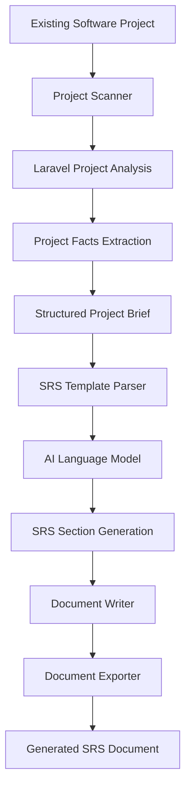

<div align="center">

# SEDOCSIDE_2

**AI-Assisted Software Documentation Generator**

Generate structured software engineering documents through automated project analysis and AI-assisted documentation.


</div>

---

## Overview

SEDOCSIDE_2 is an AI-assisted software documentation generator designed to automate the preparation of essential software engineering documents.

The system analyses an existing software project, extracts relevant technical information, and uses AI language models to assist in generating structured documentation.

The project targets three major software engineering documents:

| Document | Full Name | Purpose |
|---|---|---|
| SRS | Software Requirements Specification | Defines the system's functional and non-functional requirements. |
| SDD | Software Design Description | Describes the system architecture, components, interfaces, and design decisions. |
| STD | Software Test Documentation | Documents testing strategies, test cases, test procedures, and expected results. |

By combining automated source-code analysis with AI-assisted generation, SEDOCSIDE_2 aims to reduce the manual effort involved in preparing software documentation.

## Core Objectives

- Analyse existing software projects automatically.
- Extract system information from source code and project configuration.
- Identify application functionality, database structures, and technical dependencies.
- Generate structured SRS, SDD, and STD documents using predefined templates.
- Support local and online AI language model providers.
- Produce documentation based on actual project information.

## Features

### Implemented Components

- **Project Scanning:** Inspects a software project directory and collects information about its files, programming languages, dependencies, and project structure.
- **Laravel Analysis:** Extracts routes, middleware, database tables, migration columns, models, controllers, and Blade views.
- **Project Fact Extraction:** Converts collected scan results into a structured project brief.
- **Function Identification:** Identifies application functions from Laravel routes and assigns functional requirement IDs such as `FR_01`.
- **Database Analysis:** Identifies application tables, columns, relationships, and database configuration.
- **SRS Template Parsing:** Reads a Markdown-based SRS template and identifies sections, instructions, dependencies, and special settings.
- **Multiple AI Providers:** Supports local Ollama models and OpenAI-compatible API providers.
- **Sensitive File Protection:** Skips secret files such as `.env`, private keys, and credential files during project scanning.

### Planned Components

- Automated SRS section generation.
- Integration between project scanning, fact extraction, and AI generation.
- Automated document writing and assembly.
- Exporting completed SRS documents into supported formats.
- Complete end-to-end application workflow.

## System Workflow

The intended system workflow is:



*Note: This illustrates the intended workflow. The complete pipeline has not yet been implemented.*

## Technology Stack

| Technology | Purpose |
|---|---|
| Python | Core application and processing logic |
| HTTPX | HTTP communication with AI providers |
| Ollama | Local LLM integration |
| OpenAI-compatible APIs | Alternative online LLM providers |
| JSON | Storage of scan results and project briefs |
| Markdown | SRS template definition and structured content |

## Project Architecture

The current project is organised into separate engine modules.

```text
SEDOCSIDE_2/
│
├── engine/
│   ├── facts.py
│   ├── laravel_scanner.py
│   ├── llm.py
│   ├── scanner.py
│   ├── template_parser.py
│   ├── writer.py
│   └── exporter.py
│
├── templates/
│   └── SRS_Template_v2.md
│
├── scan_output/
│   └── Generated scan results and project briefs
│
├── main.py
├── requirements.txt
└── README.md
```

### Engine Modules

| Module | Responsibility |
|---|---|
| `scanner.py` | Scans project directories, detects languages, reads dependency files, and collects project metadata. |
| `laravel_scanner.py` | Analyses Laravel routes, migrations, models, controllers, views, and configuration. |
| `facts.py` | Converts scan results into a structured project brief and identifies application functions. |
| `template_parser.py` | Parses the SRS Markdown template into structured sections and instructions. |
| `llm.py` | Provides connections to local Ollama models and OpenAI-compatible API providers. |
| `writer.py` | Reserved for document-writing functionality. |
| `exporter.py` | Reserved for document-export functionality. |
| `main.py` | Reserved for the main application workflow. |

## SRS Template

The project currently includes `SRS_Template_v2.md`, which defines the structure and instructions for generating an SRS document.

The template follows three main chapters:

1. **Introduction**
   - Purpose
   - System Scope
   - Terminology
   - References
   - Overview

2. **General Description**
   - Product Perspective
   - Product Functions
   - User Characteristics
   - General Constraints
   - Dependencies

3. **Specific Requirements**
   - External Interface Requirements
   - User Interfaces
   - Functional Requirements
   - Use Cases
   - Structural Requirements
   - Behavioral Requirements
   - Design Constraints Requirements
   - Quality Requirements

The template also supports special instructions:

| Setting | Purpose |
|---|---|
| `@type: owner` | Reserves a section for information provided by the project owner. |
| `@source: scanner` | Marks a section for information extracted from project files. |
| `@write: last` | Delays a section until other sections are completed. |
| `@after: 3.3` | Specifies that a section must be written after another section. |
| `@table: A \| B \| C` | Defines the required table columns. |

## AI Integration

SEDOCSIDE_2 uses a provider-based LLM connection structure.

### Supported Providers

| Provider | Description |
|---|---|
| Ollama | Runs language models locally through the Ollama service. |
| OpenAI-compatible API | Connects to compatible online providers such as Groq and OpenRouter. |

The default configuration uses:

- Provider: Ollama
- Model: `qwen2.5:7b`
- Temperature: `0.2`
- Context window: `4096` tokens

The provider and model settings can be changed through the `LLMSettings` configuration in `engine/llm.py`.

## Getting Started

### Prerequisites

- Python 3.10 or later
- pip
- Git
- Ollama (for local AI inference)

An OpenAI-compatible API provider can be used instead of Ollama.

### 1. Clone the Repository

```bash
git clone https://github.com/Jacqueson1/SEDOCSIDE_2.git
cd SEDOCSIDE_2
```

### 2. Create a Virtual Environment

```bash
python -m venv .venv
```

Activate it:

**Windows**

```powershell
.venv\Scripts\activate
```

**Linux / macOS**

```bash
source .venv/bin/activate
```

### 3. Install Dependencies

```bash
pip install -r requirements.txt
```

### 4. Configure Ollama

Install Ollama and download the default model:

```bash
ollama pull qwen2.5:7b
```

Make sure the Ollama service is running before testing the connection.

## Running Individual Components

The current implementation allows several engine components to be tested independently.

### 1. Scan a Software Project

```bash
python engine/scanner.py "PATH_TO_PROJECT"
```

Example:

```bash
python engine/scanner.py "C:\laragon\www\expense-tracker"
```

The scanner collects project information and saves the results inside `scan_output/`.

### 2. Generate a Project Brief

After scanning a project:

```bash
python engine/facts.py
```

To select a specific scan:

```bash
python engine/facts.py expense-tracker
```

You can also provide a project description:

```bash
python engine/facts.py expense-tracker --description "A personal expense tracking web application."
```

The generated brief is saved in JSON and text formats.

### 3. Parse the SRS Template

```bash
python engine/template_parser.py
```

To specify another template:

```bash
python engine/template_parser.py templates/SRS_Template_v2.md
```

### 4. Test the AI Connection

```bash
python engine/llm.py
```

To test another installed Ollama model:

```bash
python engine/llm.py phi3
```

## Project Data and Output

The scanner stores its results outside the scanned software project.

```text
scan_output/
│
├── project_scan.json
├── project_brief.json
└── project_brief.txt
```

The actual filenames are generated using the scanned project's directory name.

- `*_scan.json`: Contains the collected project information.
- `*_brief.json`: Contains the structured project brief.
- `*_brief.txt`: Contains the readable project information prepared for AI processing.

## Current Limitations

SEDOCSIDE_2 is still under development. The following limitations apply to the current repository:

- The complete SRS generation pipeline is not connected.
- The main application entry point has not been implemented.
- The document writer and exporter modules are currently empty.
- Laravel analysis is the most developed framework-specific scanning implementation.
- Project descriptions may need to be supplied manually when the scanned project has no meaningful README.
- Project scanning uses static source-code analysis and may not understand every dynamic implementation pattern.
- No automated test suite is currently included.

## Development Roadmap

The following areas represent potential next development steps:

- [ ] Complete the main application workflow.
- [ ] Integrate the scanner, fact extractor, template parser, and LLM modules.
- [ ] Implement automated SRS section generation.
- [ ] Implement document writing and assembly.
- [ ] Implement document export functionality.
- [ ] Improve support for non-Laravel projects.
- [ ] Add automated tests for individual engine components.
- [ ] Improve error handling and generated requirement validation.

## Project Status

**Work in Progress**

SEDOCSIDE_2 is an ongoing development project. Its current focus is building the individual components required for automated software project analysis and AI-assisted SRS generation.

The repository will continue to evolve as the components are integrated and additional functionality is implemented.

---

<div align="center">

**SEDOCSIDE_2**

AI-Assisted Software Requirements Specification Generator

</div>
